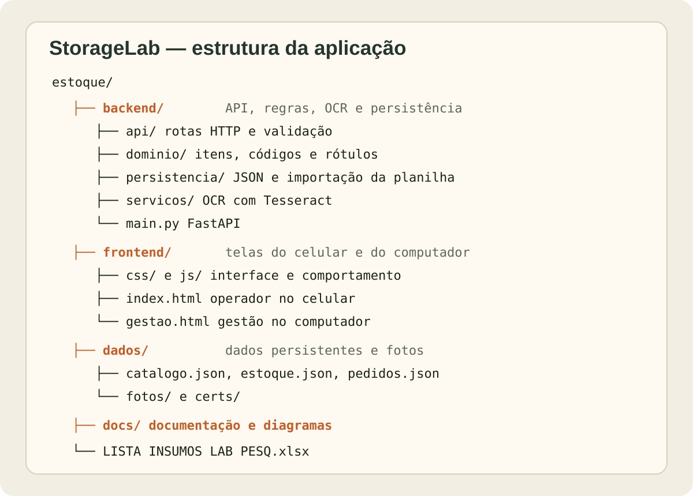
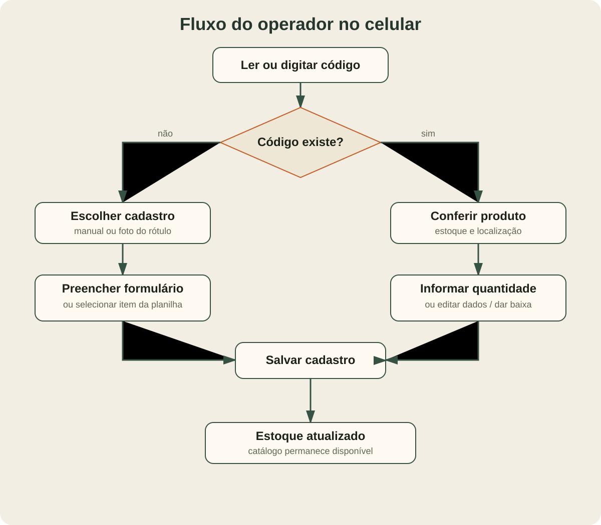
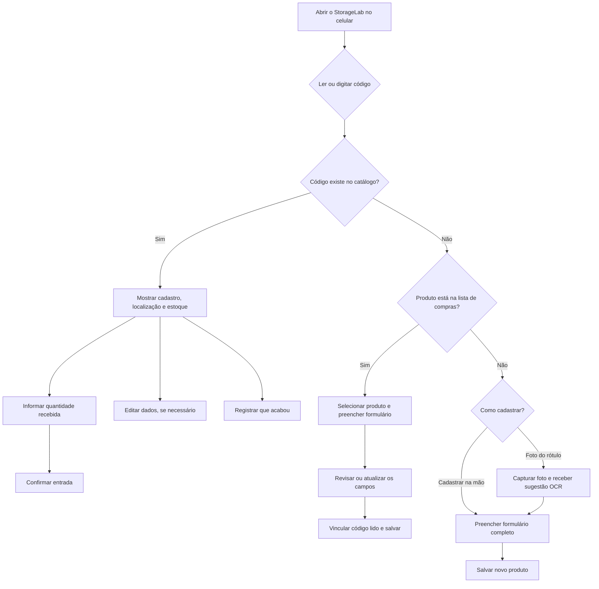
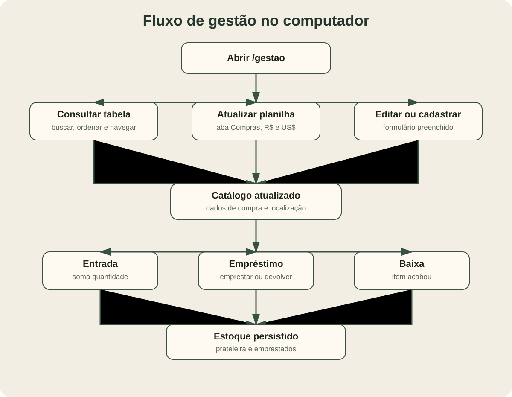
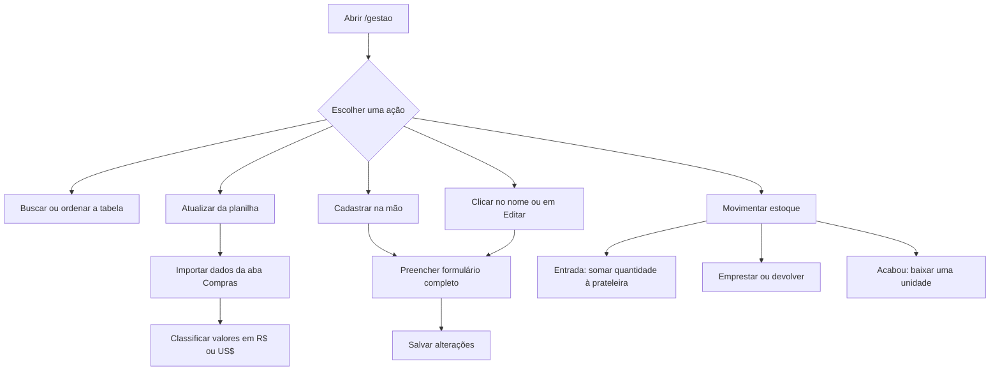

# StorageLab

Aplicação local para controle do estoque de laboratório. O computador do laboratório executa o servidor e pode ser acessado pelo próprio PC e por celulares na mesma rede Wi-Fi.

## Estrutura da aplicação



```text
estoque/
├── backend/
│   ├── api/                 rotas HTTP e validação dos dados
│   ├── dominio/             regras de itens, códigos e rótulos
│   ├── persistencia/        importação da planilha e arquivos JSON
│   ├── servicos/            OCR do rótulo com Tesseract
│   ├── main.py              aplicação FastAPI
│   └── __main__.py          inicialização do servidor HTTPS
├── frontend/
│   ├── css/                 estilos das telas
│   ├── js/                  leitura, cadastro, gestão e API
│   ├── index.html           tela do operador no celular
│   └── gestao.html          painel de gestão no computador
├── dados/
│   ├── catalogo.json        catálogo permanente de produtos
│   ├── estoque.json         prateleira e itens emprestados
│   ├── pedidos.json         cópia dos pedidos importados
│   ├── fotos/               fotos de rótulos
│   └── certs/               certificado HTTPS local
├── docs/                    documentação do projeto
├── LISTA INSUMOS LAB PESQ.xlsx  planilha usada na importação
├── requirements.txt         dependências Python
└── LICENSE
```

## Fluxo do operador no celular





## Fluxo de gestão no computador





## Documentação detalhada

| Documento | Conteúdo |
|---|---|
| [o-que-a-aplicacao-faz.md](o-que-a-aplicacao-faz.md) | Regras de negócio e funcionalidades atuais |
| [uso.md](uso.md) | Como iniciar e utilizar o sistema |
| [arquitetura.md](arquitetura.md) | Camadas, dados e APIs |
